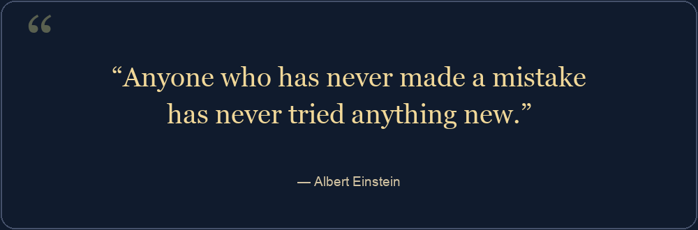
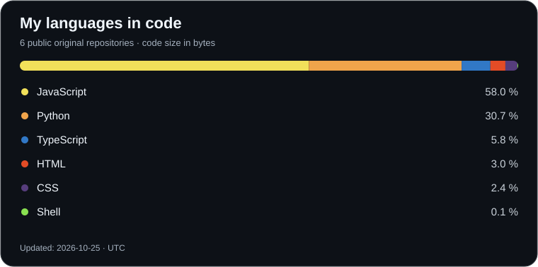

**Fullstack developer from Frankfurt am Main.**

**Frontend · Backend · REST APIs · JavaScript · TypeScript · Python**

## My portfolio

Projects, skills and contact details, with interactive animations and a switch between German and English.

[**Visit portfolio →**](https://michael-koch-portfolio.vercel.app/) · [Projects](https://michael-koch-portfolio.vercel.app/cases.html) · [Contact](https://michael-koch-portfolio.vercel.app/contact.html)

## Hi, I’m Michael 👋

I enjoy developing software, exploring new technologies and turning ideas into working applications. What motivates me most is solving challenging problems and creating something that helps people in their everyday lives.

I’m a problem solver who enjoys turning everyday, manual processes into digital solutions. I take ideas through the entire journey: from the first concept through development to a finished application that makes everyday life easier.

## Technologies & tools

| Area | Technologies |
| --- | --- |
| Frontend | HTML, CSS, JavaScript, TypeScript, React, Bootstrap, Tailwind CSS |
| Backend & APIs | Node.js, Express, Python, REST APIs |
| Databases & SQL | MongoDB, MySQL, PostgreSQL, SQLite, MariaDB · SQL (query language) |
| Development & tools | Git, GitHub, Azure DevOps, Docker, Vite |
| Cloud & DevOps | Microsoft Azure, Azure DevOps, AWS (Amazon Web Services) |
| Interactive 3D | Three.js, React Three Fiber, Rapier |

## My programming languages

Updated automatically every day. Includes public original repositories, excluding forks and this profile repository. Shares represent code size, not time spent or proficiency. Team projects may be included.

## AI, MCP & learning 🤖

I’m expanding my knowledge of artificial intelligence and exploring how it connects to web development and Python.

- **MCP (Model Context Protocol):** connecting AI applications with tools, APIs and data sources.
- **LLMs (Large Language Models):** exploring language models and their integration into applications.
- **Machine Learning:** learning how models identify patterns in data and make predictions.
- **Deep Learning:** building an understanding of neural networks and how they are trained.

My focus is on understanding the fundamentals and exploring practical applications. These are current learning interests; my linked projects show my work so far.

## Selected projects

Tic-tac-toe for two people on one device. Play directly in the browser; the repository also includes a local Flask backend with SQLite for saving games. The browser demo runs without server-side storage.

[**Play now →**](https://michkffm.github.io/Tic-Tac-Toe/) · [Repository](https://github.com/michkffm/Tic-Tac-Toe)

Desktop tool for PDF conversion, optical character recognition and EPUB output.

Track applications and their status. Data stays in the browser.

Learning project for email verification followed by password creation.

Team project for services, messages and reviews. My contribution: project management and development across several areas.

Project READMEs describe setup, development status and known limitations.

## Let’s get in touch

Questions about a project or an idea for working together? Email me directly:

**[michkffm@icloud.com](mailto:michkffm@icloud.com)**

The visitor counter measures image requests, not unique people.
