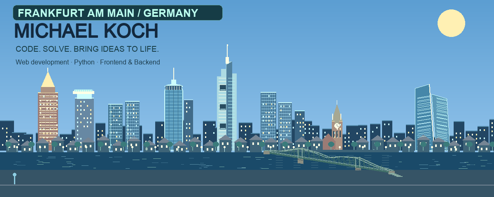
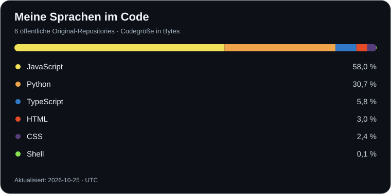

**Fullstack-Softwareentwickler aus Frankfurt am Main.**

**Frontend · Backend · REST-APIs · JavaScript · TypeScript · Python**

## Hi, ich bin Michael 👋

💻 Ich bin Softwareentwickler mit Leidenschaft für moderne Technologien und digitale Lösungen.

Die Welt der Softwareentwicklung verändert sich ständig – genau das begeistert mich. Ich lerne kontinuierlich dazu, entwickle meine Fähigkeiten stetig weiter und entdecke gerne neue Technologien, Werkzeuge und Ansätze. Mein Ziel ist es, innovative Software zu entwickeln, die echte Probleme löst und Menschen im Alltag unterstützt.

   

## Technologien & Werkzeuge

| Bereich | Technologien |
| --- | --- |
| Frontend | HTML, CSS, JavaScript, TypeScript, React, Bootstrap, Tailwind CSS |
| Backend & APIs | Node.js, Express, Python, REST-APIs |
| Datenbanken & SQL | MongoDB, MySQL, PostgreSQL, SQLite, MariaDB · SQL (Abfragesprache) |
| Entwicklung & Werkzeuge | Git, GitHub, Azure DevOps, Docker, Vite |
| Cloud & DevOps | Microsoft Azure, Azure DevOps, AWS (Amazon Web Services) |
| Interaktive 3D-Welten | Three.js, React Three Fiber, Rapier |

## Meine Programmiersprachen

## Ausgewählte Projekte

