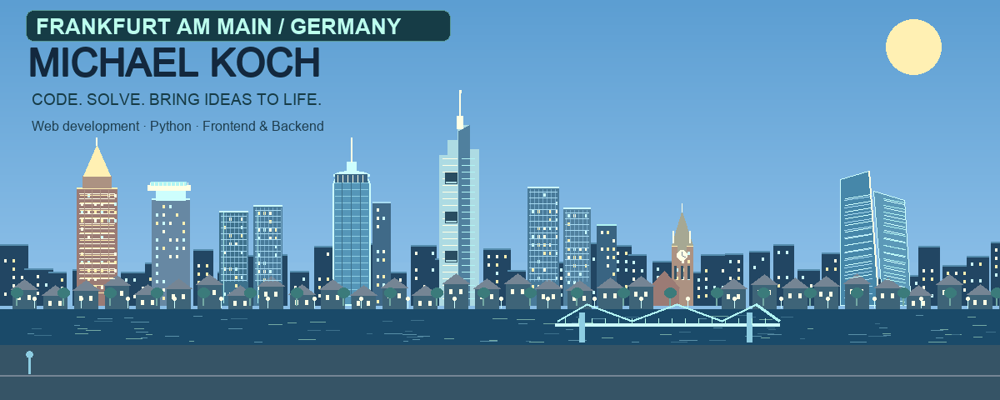
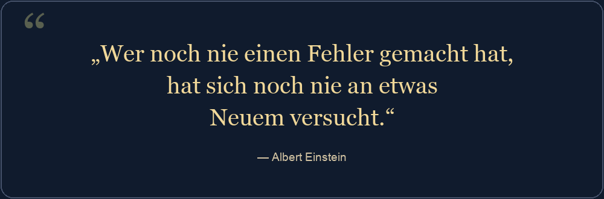
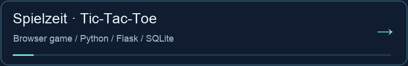
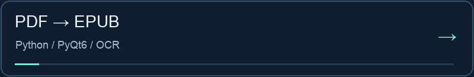
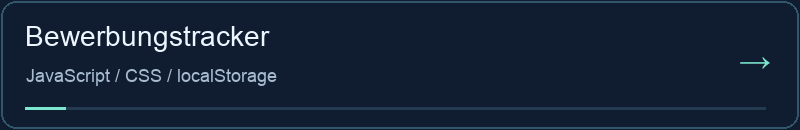
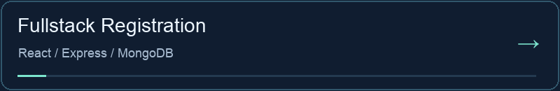
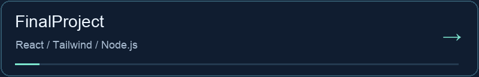

**Fullstack-Softwareentwickler aus Frankfurt am Main.**

**Frontend · Backend · REST-APIs · JavaScript · TypeScript · Python**

## Hi, ich bin Michael 👋

Ich entwickle gerne Software, entdecke neue Technologien und mache aus Ideen funktionierende Anwendungen. Besonders motiviert mich, knifflige Probleme zu lösen und etwas zu schaffen, das Menschen im Alltag weiterhilft.

Ich denke in Lösungen und verwandle analoge Abläufe gerne in digitale Möglichkeiten. Dabei begleite ich den gesamten Weg: von der ersten Idee über die Entwicklung bis zum fertigen Programm, das den Alltag einfacher macht.

## Technologien & Werkzeuge

| Bereich | Technologien |
| --- | --- |
| Frontend | HTML, CSS, JavaScript, TypeScript, React, Bootstrap, Tailwind CSS |
| Backend & APIs | Node.js, Express, Python, REST-APIs |
| Datenbanken & SQL | MongoDB, MySQL, PostgreSQL, SQLite, MariaDB · SQL (Abfragesprache) |
| Entwicklung & Werkzeuge | Git, GitHub, Azure DevOps, Docker, Vite |
| Cloud & DevOps | Microsoft Azure, Azure DevOps, AWS (Amazon Web Services) |
| Interaktive 3D-Welten | Three.js, React Three Fiber, Rapier |

## KI, MCP & aktuelle Lernthemen 🤖

Ich erweitere mein Wissen über künstliche Intelligenz und beschäftige mich mit der Verbindung von KI, Webentwicklung und Python.

- **MCP (Model Context Protocol):** KI-Anwendungen mit Werkzeugen, APIs und Datenquellen verbinden.
- **LLMs (Large Language Models):** große Sprachmodelle verstehen und ihre Einbindung in Anwendungen erkunden.
- **Machine Learning:** lernen, wie Modelle Muster in Daten erkennen und Vorhersagen treffen.
- **Deep Learning:** neuronale Netze und deren Training verstehen.

Mein Fokus liegt darauf, die Grundlagen zu verstehen und praktische Einsatzmöglichkeiten zu erkunden. Diese Themen sind aktuelle Lerninteressen; meine verlinkten Projekte zeigen meine bisherige Arbeit.

## Ausgewählte Projekte

Tic-Tac-Toe für zwei Personen an einem Gerät. Direkt im Browser spielbar; das Repository enthält zusätzlich ein lokales Flask-Backend mit SQLite zum Speichern von Spielständen. Die Browser-Demo läuft ohne Serverspeicherung.

[**Jetzt spielen →**](https://michkffm.github.io/Tic-Tac-Toe/) · [Repository](https://github.com/michkffm/Tic-Tac-Toe)

Desktop-Werkzeug für PDF-Konvertierung, Texterkennung und EPUB-Ausgabe.

Bewerbungen erfassen und ihren Status verfolgen. Die Daten bleiben im Browser.

Lernprojekt für E-Mail-Bestätigung und anschließende Passwortwahl.

Gemeinschaftsprojekt für Dienstleistungen, Nachrichten und Bewertungen. Mein Beitrag: Projektleitung und Mitarbeit in mehreren Bereichen.

Die Projekt-READMEs beschreiben Einrichtung, Entwicklungsstand und bekannte Einschränkungen.

## Frankfurt zu Fuß entdecken 🌆

Mein bestehendes Portfolio zeigt meine Arbeit als interaktive Stadt. Erkunde sie mit einer persönlichen Comicfigur und einem Tag- und Nachtmodus.

[**Portfolio erkunden →**](https://michael-koch-portfolio.onrender.com/)

## Kontakt

Fragen zu einem Projekt oder eine Idee für die Zusammenarbeit? Schreib mir direkt per E-Mail:

**[michkffm@icloud.com](mailto:michkffm@icloud.com)**

Der Besucherzähler erfasst Bildaufrufe, keine eindeutigen Personen.
