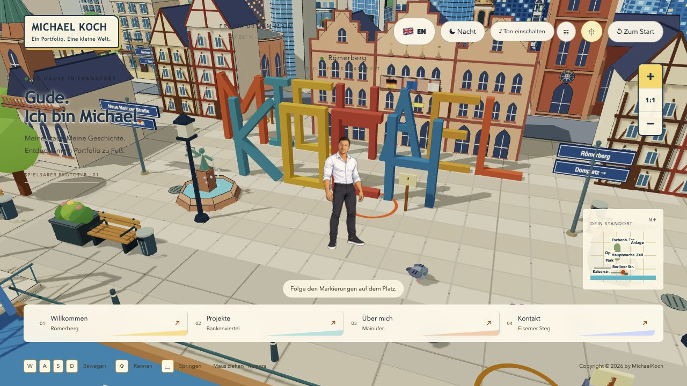

# Hi, ich bin Michael 👋

**Fullstack-Softwareentwickler aus Frankfurt am Main.**

Ich entwickle Web-Anwendungen und praktische Werkzeuge – vom übersichtlichen Formular bis zur interaktiven 3D-Welt.

## Frankfurt entdecken. Meine Arbeit kennenlernen.

Mein Portfolio ist eine kleine Stadt im Comicstil: Erkunde Frankfurt zu Fuß, entdecke meine Projekte und schreib mir über das Kontaktformular.

### [🌆 Mein interaktives Portfolio öffnen →](https://michael-koch-portfolio.onrender.com/)

Mit persönlicher Comicfigur, Tag- und Nachtmodus, Straßenlaternen und einer belebten Stadtkulisse. Die Stadt wächst um detailliertere Plätze und weitere begehbare Viertel.

*Vorschau des Entwicklungsstands vom 22. Oktober 2026. Die neuesten Stadt- und Figurenänderungen sind noch nicht in der verlinkten Live-Version veröffentlicht.*

## Technologien in meinen Projekten

| Bereich | Technologien |
| --- | --- |
| Web-Oberflächen | JavaScript, TypeScript, HTML, CSS, React |
| Backend und Daten | Node.js, Express, MongoDB |
| Interaktive 3D-Welten | Three.js, React Three Fiber, Rapier |
| Desktop-Werkzeuge | Python, PyQt6 |
| Entwicklung | Git, GitHub, Vite |

## Ausgewählte Projekte

| Projekt | Idee und technischer Schwerpunkt |
| --- | --- |
| [PDF → EPUB Konverter](https://github.com/michkffm/PDF-zu-Epub-Konverter) | Desktop-Werkzeug für digitale und gescannte PDFs. Python, PyQt6, OCR und Hintergrundverarbeitung. |
| [Bewerbungstracker](https://github.com/michkffm/Bewerbungtracker) | Bewerbungen im Browser erfassen und ihren Status verfolgen. JavaScript, DOM und localStorage. |
| [Fullstack-Registration](https://github.com/michkffm/Fullstack-Registration) | Lernprojekt für Registrierung, Passwort-Hashing und E-Mail-Bestätigung. React, Express und MongoDB. |
| [FinalProject · Dienstleistungen](https://github.com/michkffm/FinalProject) | Gemeinschaftsprojekt für Angebote, Nachrichten und Bewertungen. Meine Rolle: Projektleitung und Mitarbeit in mehreren Bereichen. |

Die Repositorys dokumentieren Funktionen, Startanleitungen und den jeweiligen Entwicklungsstand. Die Projekte entwickeln sich weiter; bekannte Einschränkungen sind dort beschrieben.

## Zusammenarbeit

Im Gemeinschaftsprojekt habe ich die Projektleitung übernommen und an verschiedenen Teilen mitentwickelt. Mir ist wichtig, dass Oberfläche, API und Datenmodell als Anwendung zusammenpassen.

**Kontakt:** [Schreib mir über mein Portfolio](https://michael-koch-portfolio.onrender.com/).
